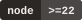
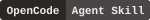
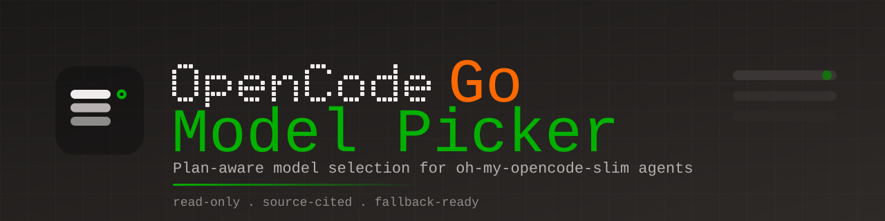

<p align="center">
  
</p>

<h1 align="center">OpenCode Go Model Picker</h1>

<p align="center">
  <em>Plan-aware model selection for your OpenCode agents — native, oh-my-opencode-slim, or plugin-injected. Read-only, source-cited, fallback-ready.</em>
</p>

<p align="center">
  <a href="LICENSE"></a>
  
  
  
  
  <a href="https://skills.sh/sogeisetsu/opencode-go-model-picker"></a>
</p>

<p align="center">
  <a href="README-ZH.md">Chinese documentation</a>
</p>

<p align="center">
  
</p>

Choosing which OpenCode Go model each of your agents should use is fiddly. Prices,
monthly caps, and the list of available models change constantly, and the "best"
pick depends on whether you care more about cost or capability. This skill does
that homework for you: it reads your OpenCode agent config, checks the **current**
Go plan, and suggests a model for each of your custom agents — plus a fallback
chain when your setup supports one. It is **read-only**, so nothing changes until
you say yes.

---

## What it does

- **Reads your agents** — your own agents (JSON or Markdown), `oh-my-opencode-slim`
  presets, or agents from another plugin.
- **Fetches the Go plan fresh on every run**, so it never suggests a retired model
  or an outdated price.
- **Recommends a model for each custom agent.** "Custom" means any agent OpenCode
  doesn't ship: your own agents in `opencode.jsonc` or Markdown files,
  `oh-my-opencode-slim` presets, and agents from other plugins — even those
  without fallback-chain support.
- **Skips OpenCode's built-in agents** — including but not limited to Build, Plan,
  and the built-in subagents. Which agents OpenCode ships can change between
  versions, so the rule is "anything OpenCode ships is skipped", not a fixed list.
- **Adds a fallback chain** where the source supports one, so hitting a capped
  model doesn't end your session.
- **Shows its work.** Every number comes with a source and a fetch date, and
  anything it can't verify is flagged instead of guessed.

Two things it will never do: invent a price, limit, or model ID, and change your
config without showing you the change first.

### A suggestion

If you can, register your custom agents through a tool that supports ordered
fallback chains — `oh-my-opencode-slim` is one, and any other tool or plugin that
does the same works just as well. The reason is resilience: Go models get
rate-limited and retired, and a chain keeps your session running when the first
choice is unavailable. This is only a suggestion. If you don't use one, the skill
still works — it just recommends a single model for those agents.

## Requirements

- **OpenCode** with Agent Skills support. The skill lives in
  `~/.config/opencode/skills/`.
- **At least one custom agent to tune** — an agent you define yourself in
  `opencode.jsonc` or a Markdown file, an
  [`oh-my-opencode-slim`](https://github.com/alvinunreal/oh-my-opencode-slim)
  preset, or an agent from another plugin. (OpenCode's built-in agents don't need
  tuning.)
  - `oh-my-opencode-slim` is **optional**. It is only one of the supported
    sources; if you happen to use it, the skill treats its installed schema as the
    source of truth.
- **Node.js 22+**, for the single entry point (tested on Node 22.23.1). The local
  usage read uses `node:sqlite`; on a runtime without it the run reports the gap
  and continues on the price seed. Behind a proxy the network steps need Node 24+
  or a 22.x build that backported `NODE_USE_ENV_PROXY` (22.23.1 is verified) —
  otherwise fetch bypasses the proxy and the run says so on stderr.
- **Optional: the OpenCode Console MCP.** Not required to get recommendations, but
  it is the only authoritative source for what you actually spent. Without it the
  report labels its money an estimate and tells you which numbers cannot be
  trusted (`references/plan-facts.md`).

## Installation

Clone the repository into your OpenCode skills directory, so the folder name
matches the skill's `name`:

**Linux / macOS**
```bash
git clone https://github.com/sogeisetsu/opencode-go-model-picker.git \
  ~/.config/opencode/skills/opencode-go-model-picker
```

**Windows (PowerShell)**
```powershell
git clone https://github.com/sogeisetsu/opencode-go-model-picker.git `
  "$env:USERPROFILE\.config\opencode\skills\opencode-go-model-picker"
```

**Via the skills.sh CLI**

Install straight from [skills.sh](https://skills.sh) with the
[`skills`](https://github.com/vercel-labs/skills) CLI:

```bash
npx skills add sogeisetsu/opencode-go-model-picker
```

By default it installs into the current project's skill directories. Add
`-g` to install into your user directory instead, and pick target agents
with `-a` (for example `opencode`):

```bash
npx skills add sogeisetsu/opencode-go-model-picker -g -a opencode
```

**Minimal install.** You don't need the whole repository. At runtime the skill
only uses `SKILL.md`, `references/`, and `scripts/`. Copy just those three into
`~/.config/opencode/skills/opencode-go-model-picker/` and skip the rest (README,
LICENSE, `assets/`, `zh/`, …) — they are documentation only.

Then check that the entry point runs:

```bash
node scripts/go.mjs --help
```

### Let an AI agent install it

Copy the block below and paste it to your AI agent:

```text
Install the "OpenCode Go Model Picker" skill for me.

1. Get the repository: https://github.com/sogeisetsu/opencode-go-model-picker
2. Copy only these into my global OpenCode skills directory
   (~/.config/opencode/skills/opencode-go-model-picker/):
   - SKILL.md
   - references/
   - scripts/
3. Do not copy the rest of the repo (README, LICENSE, assets, ...).
4. Verify by running "node scripts/go.mjs --help" inside the installed folder and
   confirming it prints the four verbs.
5. Tell me the install path and whether it worked.
```

## Quick start

Once installed, invoke the skill from OpenCode with its slash command — no
input needed:

`/opencode-go-model-picker`

The skill reads your agent config, fetches the current Go plan, and comes back
with its recommendations. In the TUI, if it does not show up in the `/`
autocomplete list, type `/skills` and pick it from the skill list.

## Usage

Just ask in plain language. For example:

- "Pick the best OpenCode Go models for each of my agents."
- "Is my current agent model config still a good fit for the current Go plan?"
- "Give me a paste-ready preset block for OpenCode Go, with fallbacks."
- "I define my agents in `opencode.jsonc` — recommend models for them."
- "Use budget mode — keep my agent models as cheap as possible."

Three modes let you decide the trade-off between price and capability:

| Mode | What it optimizes for |
|---|---|
| `budget` | The cheapest model that still does the job. |
| `balanced` | The best value — a sensible mix of price and capability (default). |
| `quality` | The strongest model on Go, with cost as a secondary concern. |

Name a mode in your request and it is used as-is. If you don't name one, the skill
asks two short weighted questions the first time (what matters most, what you mainly
use it for), resolves them into a mode, remembers the answer, and reuses it on later
runs — you can always name a mode to override it, and skipping the questions just
uses `balanced`. The report includes an auditable table of the decision factors.

In `balanced`, the priciest pick for a normal high-volume agent should be only
slightly more expensive than the current cheap-but-capable baseline (DeepSeek V4.1
Flash at the time of writing) and clearly stronger; if nothing clears that bar, the
baseline itself is the pick.

Every run starts with a **basis line** and ends with a data appendix:

`Basis: Console bill (authoritative) | <date> | pool <usd>/mo (provisional)` —
or `Basis: Estimate (official unit price × median tokens, high by about N×)`, or
`Basis: Uncalibrated`. One basis for the whole table; a report never mixes two.

1. **Recommendation table** — one row per custom agent: agent name, recommended
   chain (with ⚠ markers for limited-time, geo, or training caveats), headroom
   (`$ cap / official requests / observed requests`), accounted `$/session`
   (median · P90), share of that model's cap, 10 runs as a percentage of the 5h ·
   week · month pool (three independent windows, never summed), actual monthly
   occupancy, and why.
2. **Usage evidence** — spend and requests for the last 30 days, the last 7 days
   with a month-end projection, candidates without an ELO rating (`n/m` plus
   ids), dead chain ids from the run's `deadChainIds`, and the main agents'
   share of spend (share only; they are never re-assigned).
3. **Paste-ready config** — a complete copy-pasteable JSONC block per detected
   source: `oh-my-opencode-slim.json` for the slim preset, `opencode.jsonc` for a
   native `agent` block (both when both are detected), with fallback chains
   preserved where the source supports them.
4. **Highlights** — one paragraph: mode + rationale, the price ceiling, the full
   caveat text, plan changes vs the last snapshot, and what the basis line means
   for trust.
5. **Data appendix** — sources with fetch dates (seed labeling), the snapshot
   diff, the relevant-models table, the calibration line (bias, date, drift), the
   first-run decision-factors table, the manual-verification list, and the verify
   commands.
6. **Console guidance** — only when the Console MCP is not authorized: the state,
   what it costs you to run without it, and the exact steps to enable it.

The skill then **stops and asks** before applying anything.

## How it works

The skill is a single entry point (`scripts/go.mjs`) plus one reference the model
reads for judgement calls. A run is three steps:

```bash
node scripts/go.mjs run --out run.json       # agents, Console, usage, data, diff, basis
node scripts/go.mjs report --run run.json --picks picks.json --out report.md
node scripts/go.mjs check report.md --run run.json
node scripts/go.mjs apply --run run.json --picks picks.json --target <file>   # diff only
```

1. **`run`** discovers custom agents (native, `oh-my-opencode-slim`, plugin),
   probes the Console state, reads the local usage DB, refreshes catalog, prices
   and scores **in one serial pass**, diffs the plan against the previous snapshot
   and decides the `Basis:` line. Every step degrades instead of failing: offline
   runs use the dated seeds, a missing DB or Console is reported, a stale seed is
   labelled `EXPIRED`. The output is one `run.json` with a source and date for
   every number.
2. **The model decides** — a 2–4 entry chain and a one-sentence `why` per agent.
   It verifies capabilities (vision above all) in the model's own lab docs and
   keeps the per-model cap separate from the plan pool.
3. **`report` renders the table, money columns and config blocks; `check` gates
   it; `apply` prints the exact diff and writes only the file the user names,
   only after confirmation.**

A few details worth knowing:

- **Go limits are per model, in monthly dollars.** Each model carries its own cap
  with 5-hour = 20%, weekly = 50%, monthly = 100% slices, and the plan as a whole
  has a separate pool the Console reports occupancy against. The two layers are
  never mixed: a "share of this model" and a "share of the plan" are different
  claims. Because each model has its own cap, another Go model is still usable when
  one is capped — which is why the first fallback is often another Go model.
- **Price is not one number.** Some models are priced by context-length tier, some
  double in peak hours (per message timestamp, not per session), and some bill
  cache writes. One implementation prices all of it and reports anything it had to
  assume.
- **Same $ limit ≠ same throughput.** Models burn different numbers of tokens per
  request, so the plan's estimated request counts matter as much as the dollar
  limit. The report prints the official estimate *and*, when a bill exists, the
  observed count — never one without the other.
- **It flags the fine print.** Limited-time multipliers (with the base limit they
  fall back to), geo-restricted models, and "Contributor" tiers that train on your
  prompts and completions are called out — the last one is opt-in and never
  recommended silently.
- **Fallback chains depend on your tool.** An array like `model: ["a", "b", "c"]`
  is an ordered failover chain in `oh-my-opencode-slim` (key names and behavior can
  differ between builds — your installed `oh-my-opencode-slim.schema.json` is the
  authority). Agents defined directly in OpenCode take a single `model` (no chain),
  so there the skill recommends one model and says so.
- **Capabilities come from the lab, not the name.** The skill verifies a model's
  abilities in its own lab documentation, never infers them from the model ID.
  This matters most for **vision** input.
- **Ability scores and prices ship with the skill.** Two committed seeds
  (`references/model-scores.json`, `references/model-prices.json`) keep the first
  run offline-capable. A seed is reused only while its dates still match upstream,
  is always labelled as a seed, and `null` is left unfilled rather than guessed.
- **Failure paths are explicit.** An unreachable catalog or network falls back to
  the snapshot cache and the dated seeds; with no data source at all the run says
  `data.quality: none` instead of inventing numbers.

### Where the detail lives

| Read | For |
|---|---|
| [`references/plan-facts.md`](references/plan-facts.md) | plan facts, Console states and fallbacks, capability verification, the risks to flag |
| `scripts/go.mjs --help` | the four verbs and their flags |
| [`SKILL.md`](SKILL.md) | what the model is asked to do |

## Data sources

Fetched fresh every run when the network allows; the committed seeds cover offline
runs. Facts and fallbacks: [`references/plan-facts.md`](references/plan-facts.md).

| Priority | Source | URL | Gives |
|---|---|---|---|
| 0 | Console MCP (optional) | https://opencode.ai/console/mcp | authoritative `cost_usd` / requests / tokens, per-model split, budget policies |
| 1 | Go landing page | https://opencode.ai/go | latest promos + featured usage table with estimated requests per 5h |
| 2 | Go docs | https://opencode.ai/docs/go/ | full model / price / monthly-limit table + estimated requests |
| 3 | Models endpoint | https://opencode.ai/zen/go/v1/models | live catalog ids |
| 4 | models.dev | https://models.opencode.ai/providers/opencode-go/ | context / output / price / capabilities |
| 5 | julien.cloud tracker | https://julien.cloud/opencode-go-models/ | merged view + price-change / deprecation log |
| 6 | LMArena | https://lmarena.ai/ ([dataset](https://huggingface.co/datasets/lmarena-ai/leaderboard-dataset) via the HF datasets-server) | Arena ELO: overall / coding / vision (committed seed; no key, no browser) |
| — | Price seed | `references/model-prices.json`, refreshed from https://models.dev/api.json (provider `opencode-go`) | committed per-model input / output / cached read / cached write price, context tiers, cap, peak hours and promos (dated offline fallback; a live read always wins) |

## Safety and privacy

- **Read-only by default.** Nothing is written until you confirm, and then you see
  exactly what changes — in `oh-my-opencode-slim.json`, `opencode.jsonc`, agent
  Markdown files, or wherever the change belongs.
- **Local reads:** your OpenCode config under `~/.config/opencode/` (including
  `agents/`) and the installed plugin's schema. When you opt into calibration, it
  also reads your **local OpenCode usage database**
  (`~/.local/share/opencode/opencode.db`, read-only, via `node:sqlite`) to total
  what each agent and model cost. Nothing from that database is uploaded; the
  script prints aggregates only.
- **Network access:** the public pages above, the unauthenticated `opencode.ai`
  models endpoint, the public LMArena dataset on Hugging Face (only when the score
  seed is stale), and — only if you enable it — your own OpenCode Console MCP
  account. A system proxy is used automatically if configured. No credentials and
  no personal data are sent, and no token is ever printed.
- **No invented numbers.** Every figure carries a source and a fetch date, and
  anything unverifiable is flagged for a manual check.
- **Unofficial.** This project is not affiliated with, endorsed by, or sponsored
  by OpenCode, SST, or any model vendor. Model names and prices belong to their
  respective owners.

## Contributing

Contributions are welcome. See [`CONTRIBUTING.md`](CONTRIBUTING.md) (English) or
[`CONTRIBUTING-ZH.md`](zh/CONTRIBUTING-ZH.md) (Chinese).

For personal privacy this project intentionally does **not** commit a project
`AGENTS.md`, contrary to the usual convention. Shareable conventions live in
[`CONTRIBUTING.md`](CONTRIBUTING.md).

## Changelog

See [`CHANGELOG.md`](CHANGELOG.md) (English) or
[`CHANGELOG-ZH.md`](zh/CHANGELOG-ZH.md) (Chinese).

## License

Copyright (C) 2026 sogeisetsu

Licensed under the **GNU General Public License v3.0 or later** (`GPL-3.0-or-later`).

This project is free software: you can redistribute it and/or modify it under the
terms of the GNU General Public License as published by the Free Software
Foundation, either version 3 of the License, or (at your option) any later
version. It is distributed in the hope that it will be useful, but WITHOUT ANY
WARRANTY; without even the implied warranty of MERCHANTABILITY or FITNESS FOR A
PARTICULAR PURPOSE. See the GNU General Public License for more details.

See [`LICENSE`](LICENSE) for the full text (the authoritative English version), or
[`zh/LICENSE-ZH.md`](zh/LICENSE-ZH.md) for an unofficial Chinese reference translation.

## Provenance

Built after surveying existing options (September 2026): no official or well-known
skill does plan-aware OpenCode Go agent model selection. Closest analogs are the
dashboard generator
[`itsmylife44/cliproxyapi-dashboard`](https://github.com/itsmylife44/cliproxyapi-dashboard)
(`oh-my-opencode-slim-config-generator.tsx`, MIT) and the cost-profile request
[`code-yeongyu/oh-my-openagent#1768`](https://github.com/code-yeongyu/oh-my-openagent/issues/1768).
Official Go data sources plus `oh-my-opencode-slim`'s static per-agent role
guidance are reused here. The skill was later generalized from
`oh-my-opencode-slim`-only to any OpenCode agent source.
